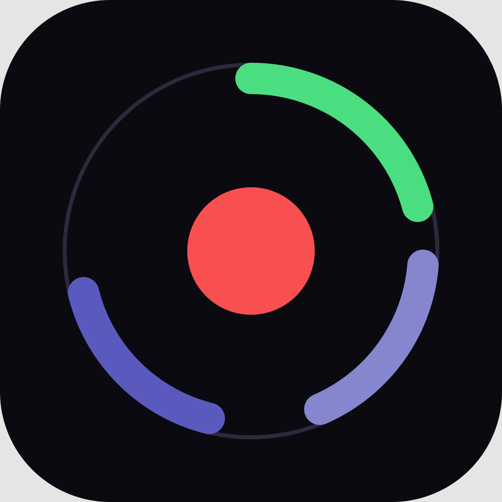

<!-- portfolio-badge -->

<!-- portfolio-badge -->

# PolyRec

Windows 用のマルチトラック画面録画ソフトです。

[English](README.md) | 日本語

 

## PolyRec を選ぶ理由

Windows の画面録画ソフトの多くは、音声を 1 つのトラックにまとめてしまい、何を残すかを録画を始める前に決めさせます。PolyRec は違います。

- **音声ソースごとに別トラック。何を残すかは録画時ではなくエクスポート時に決められます。** システム音声、マイク、実行中の各アプリ（Discord、ゲーム、Spotify など）がそれぞれ独立して録音されます。録画したあとでも、最終的なファイルに何を残すかを選び直せます。
- **1 つのアプリの音だけを、設定なしで分離。** 「このアプリの音声のみ」は、Windows 標準の Process Loopback Capture API で 1 つのプロセスの音だけを録音します。仮想オーディオケーブルもミキサーの設定も要りません。
- **決定的瞬間を逃さない。** ハイライトは、録画ボタンを押していないときもバックグラウンドで直近の映像を保持し続けます。何か起きたらショートカットキーを 1 回押すだけで、直前 N 秒を保存できます。
- **編集にもアップロードにもそのまま使えるファイル。** 録画も保存したハイライトも、30・60・120・144・240 fps、またはディスプレイが出せる最も高い標準のフレームレートで、最初から最後まで一定のフレームレートで記録されます。動画編集ソフトや動画サイトが想定しているとおりの形です。
- **アカウント不要、広告なし。** PolyRec が接続するのは GitHub だけで、それもアップデートの確認とダウンロードのためです。
- **自分で確かめられるアップデート。** アプリ内の自動アップデートは、メンテナーのリリース鍵（GitHub には置いていません）で署名されたものしかインストールしません。さらに SHA256 チェックサムとビルドの来歴証明（build provenance attestation）も確認します。「ダウンロードしたものを信じるだけ」ではありません。

ビルドは [Releases ページ](https://github.com/yusukensanta/polyrec/releases/latest) から入手できます。インストール方法、全機能の一覧、使い方は[ユーザーガイド](docs/USER_GUIDE.ja.md)をご覧ください。

## ほかの録画ソフトとの比較

| | PolyRec | OBS Studio | NVIDIA App | Medal |
|---|---|---|---|---|
| 価格 | 無料、オープンソース（Apache-2.0） | 無料、オープンソース（GPL-2.0） | 無料 | 無料（有料の Premium あり） |
| GPU | Direct3D 11 対応ならどれでも | どれでも | NVIDIA のみ | どれでも |
| 音声の別トラック化 | スピーカー、マイク、**オーディオ** でチェックを入れた各アプリ | どのアプリでも可。ただしアプリごとに「アプリケーション音声キャプチャ」ソースを追加し、トラックを割り当てる必要あり | マイクを別トラックに | ゲーム、マイク、Discord |
| 直前 N 秒の保存 | ハイライト | リプレイバッファ | インスタント リプレイ | クリップ機能 |

OBS は PolyRec にできることをすべてこなし、シーン、配信、プラグインなど、それ以上のこともできます。PolyRec は、録画だけをしたいとき、事前の設定なしにアプリごとの別トラックで録りたいときのためのソフトです。

## インストール

[Releases ページ](https://github.com/yusukensanta/polyrec/releases/latest) から最新版を入手してください。各バージョンで 2 種類を公開しています。

- **`polyrec-vX.Y.Z-windows-x64-setup.exe`** — 通常のインストーラーです。ダブルクリックしてウィザードを進めると、スタートメニューのショートカットと「プログラムの追加と削除」の項目が作られます。
- **`polyrec-vX.Y.Z-windows-x64.zip`** — インストール不要のポータブル版です。展開して `polyrec.exe` をそのまま実行します。

インストーラーには署名がありません（コード署名証明書なし）。そのため初回の実行時に Windows SmartScreen が「不明な発行元」の警告を表示します。**詳細情報 → 実行** をクリックしてください。各リリースには署名付きの `SHA256SUMS.txt` とビルドの来歴証明も付いているので、警告をクリックして信じるだけでなく、ダウンロードしたファイルを自分で検証できます。検証の手順は[ユーザーガイド](docs/USER_GUIDE.ja.md#ダウンロードの検証任意)をご覧ください。

**動作環境:** Windows 10 2004 以降（ビルド 19041 以降）と、Direct3D 11 に対応した GPU。

## ドキュメント

- **[ユーザーガイド](docs/USER_GUIDE.ja.md)** — インストール、ダウンロードの検証、全機能の一覧、動作環境、使い方。
- **[CONTRIBUTING.ja.md](CONTRIBUTING.ja.md)** — ソースからのビルド、プロジェクトの構成、PR とリリースの手順。
- **[SECURITY.ja.md](SECURITY.ja.md)** — サポート対象のバージョンと、脆弱性の報告方法。
- **[CHANGELOG.ja.md](CHANGELOG.ja.md)** — リリースごとの主な変更点。

## ライセンス

Apache-2.0 — [LICENSE](LICENSE) をご覧ください。
