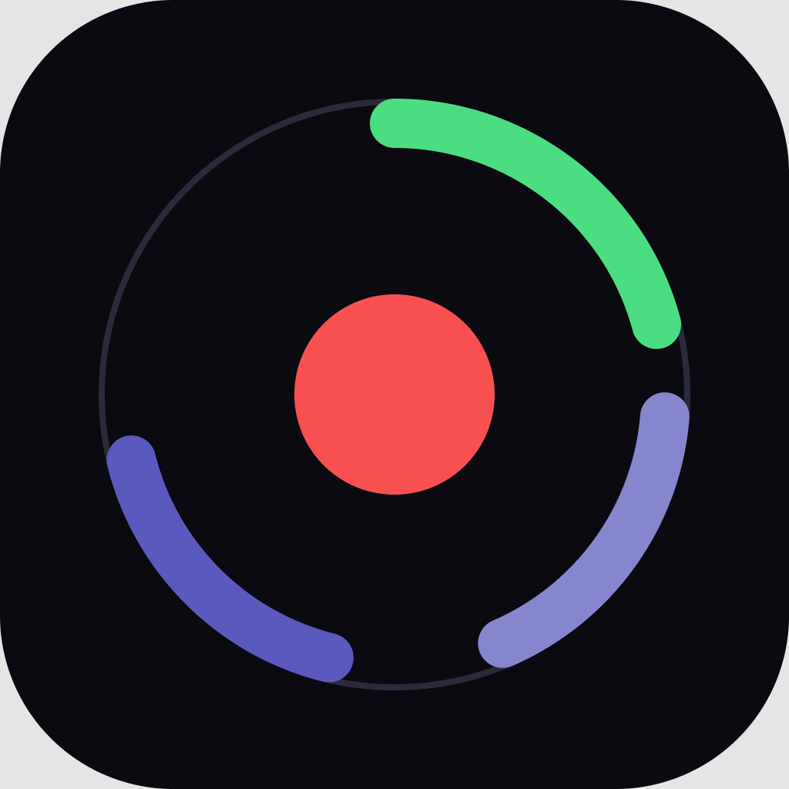

<!-- portfolio-badge -->

<!-- portfolio-badge -->

# PolyRec

Multi-track screen recorder for Windows.

English | [日本語](README.ja.md)

 

## Why PolyRec

Most Windows screen recorders hand you one flattened audio track and lock in
your choices before you hit record. PolyRec doesn't:

- **Every audio source is its own track — decided at export, not record time.** System sound, mic, and each running app (Discord, a game, Spotify, ...) record independently. Change your mind about what to keep in the final file *after* you've already recorded.
- **Isolate one app's sound with zero setup.** "App audio only" scopes capture to a single process via Windows' own Process Loopback Capture API — no virtual audio cables, no mixer config.
- **Never miss the moment.** Highlight keeps a rolling background buffer running even when you haven't pressed record — hit one hotkey to save the last N seconds after something happens.
- **Files ready to edit and upload.** Every recording and saved highlight runs at one constant frame rate — 30, 60, 120, 144 or 240 fps, or the highest standard rate your display can deliver — the way video editors and upload sites expect.
- **No account, no ads.** PolyRec connects to nothing but GitHub, to check for and download updates.
- **Updates you can actually verify.** The in-app self-updater installs nothing that isn't signed with the maintainer's release key (kept off GitHub), and checks its SHA256 checksum and build-provenance attestation too — not just "trust the download."

Grab a build from the [Releases page](https://github.com/yusukensanta/polyrec/releases/latest) and see the [User Guide](docs/USER_GUIDE.md) for installation, the full feature list, and how to use it.

## How it compares

| | PolyRec | OBS Studio | NVIDIA App | Medal |
|---|---|---|---|---|
| Price | Free, open source (Apache-2.0) | Free, open source (GPL-2.0) | Free | Free, with a paid Premium |
| GPU | Any with Direct3D 11 | Any | NVIDIA only | Any |
| Separate audio tracks | Speakers, mic, and each app you tick in **Audio** | Any app, once you add an Application Audio Capture source for it and assign it a track | Microphone on its own track | Game, mic and Discord |
| Save the last N seconds | Highlight | Replay Buffer | Instant Replay | Clipping |

OBS does everything PolyRec does and far more — scenes, streaming, plugins. PolyRec is for when you only want to record, with every app on its own track and nothing to set up first.

## Installation

Grab the latest release from the [Releases page](https://github.com/yusukensanta/polyrec/releases/latest) — two options are published for every version:

- **`polyrec-vX.Y.Z-windows-x64-setup.exe`** — a normal installer. Double-click, click through the wizard, get a Start Menu shortcut and an Add/Remove Programs entry.
- **`polyrec-vX.Y.Z-windows-x64.zip`** — portable, no installer: unzip and run `polyrec.exe` directly.

The installer is unsigned (no code-signing certificate), so Windows SmartScreen shows an "Unknown Publisher" warning on first run — click **More info → Run anyway**. Each release also ships a signed `SHA256SUMS.txt` and a build provenance attestation, so you can verify the download instead of just trusting the warning-click. See the [User Guide](docs/USER_GUIDE.md#verifying-a-download-optional) for verification steps.

**Requirements:** Windows 10 2004+ (build 19041+), and a GPU with Direct3D 11 support.

## Documentation

- **[User Guide](docs/USER_GUIDE.md)** — installation, verifying a download, full feature list, requirements, and usage walkthrough.
- **[CONTRIBUTING.md](CONTRIBUTING.md)** — build from source, project structure, and the PR/release process.
- **[SECURITY.md](SECURITY.md)** — supported versions and how to report a vulnerability.
- **[CHANGELOG.md](CHANGELOG.md)** — notable changes per release.

## License

Apache-2.0 — see [LICENSE](LICENSE).
